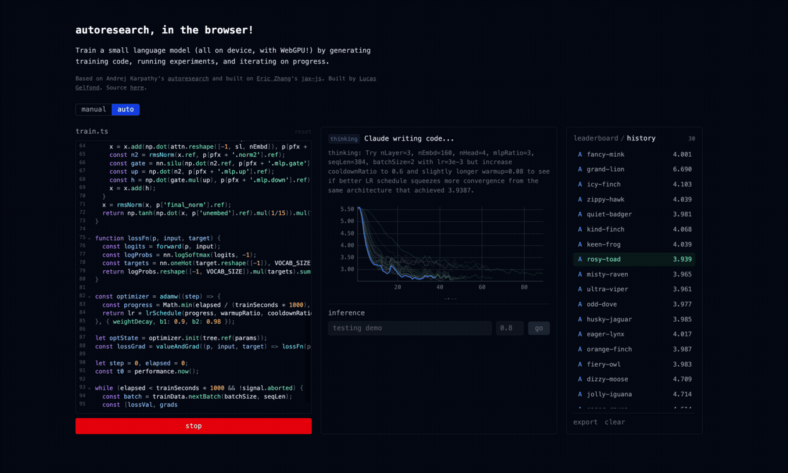

# autoresearch-webgpu

Portage navigateur de [l'autoresearch de Karpathy](https://github.com/karpathy/autoresearch) ! autoresearch-webgpu :
- utilise un modèle de langage pour créer un fichier `train.ts`, avec une boucle d'entraînement de base
- exécute l'entraînement du modèle dans le navigateur, sur le GPU de l'appareil (grâce à `jax-js`, merci [@ekzhang](https://github.com/ekzhang) !)
- évalue la perte et les résultats des expériences, puis les renvoie à un agent pour générer du nouveau code !

Rien de bien extravagant dans ce dépôt : c'est une application Svelte classique, qui utilise [pglite](https://pglite.dev/) (sans doute overkill !) pour suivre l'état des expériences. Je voulais surtout tester cette idée (et la partager), sans passer par l'installation de Python !

L'interface est entièrement en français ; tous les textes affichés sont centralisés dans [`src/lib/i18n/fr.ts`](src/lib/i18n/fr.ts).

Essayez la démo en ligne sur [autoresearch.lucasgelfond.online](https://autoresearch.lucasgelfond.online)
